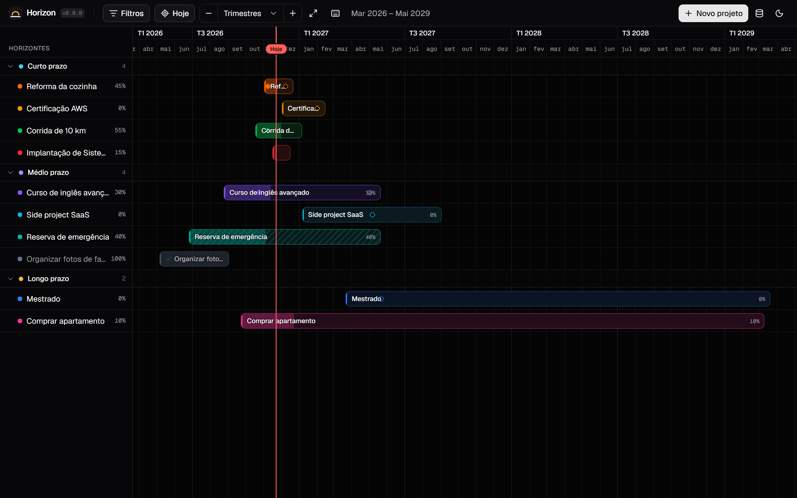
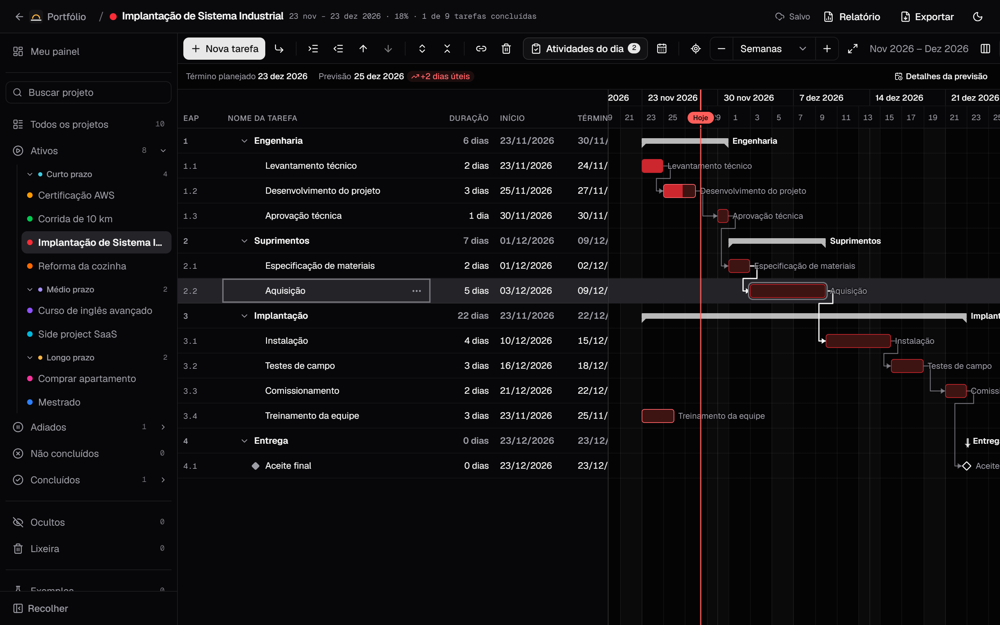
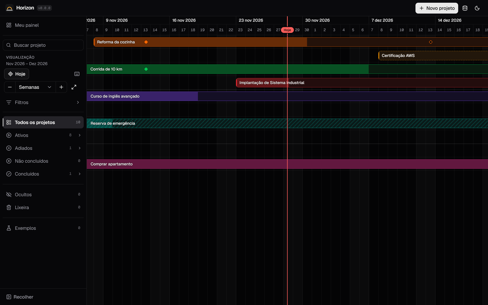
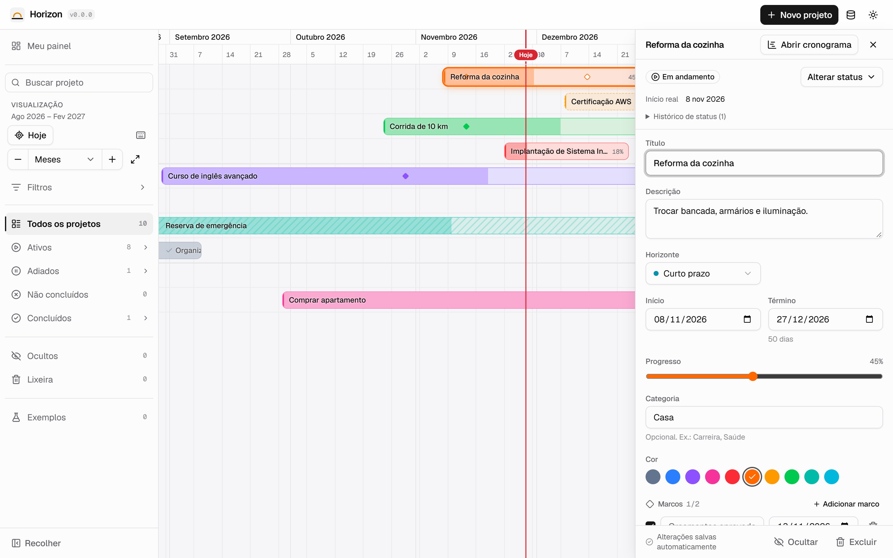
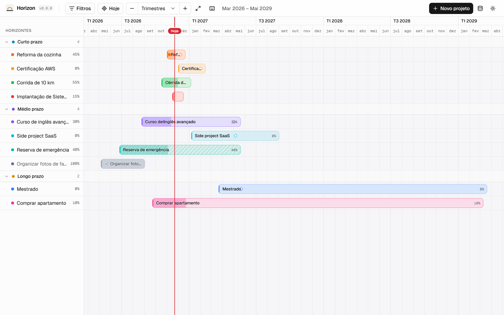
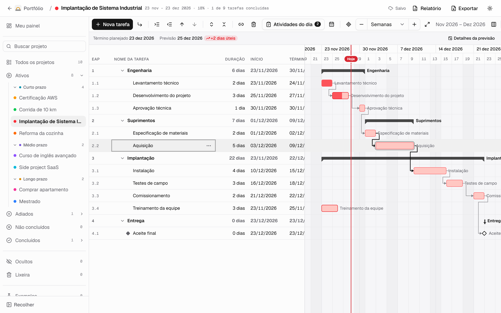
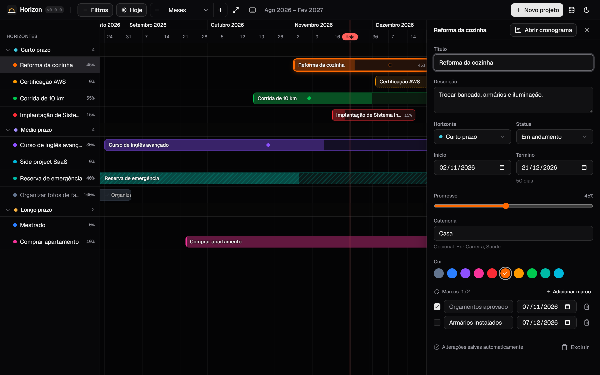
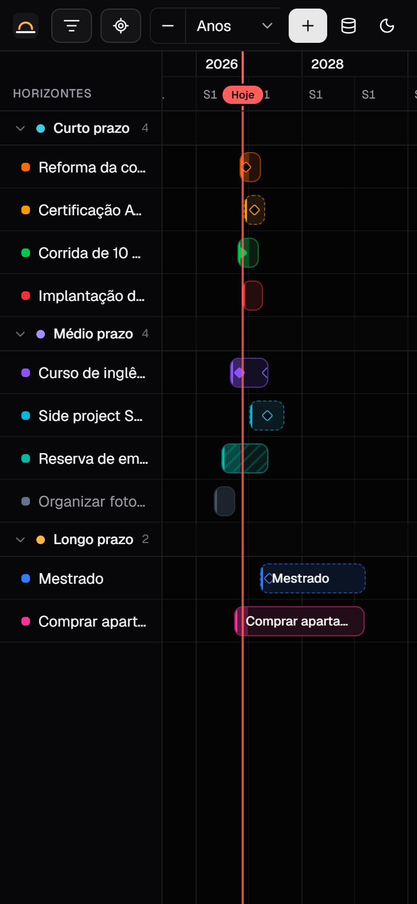
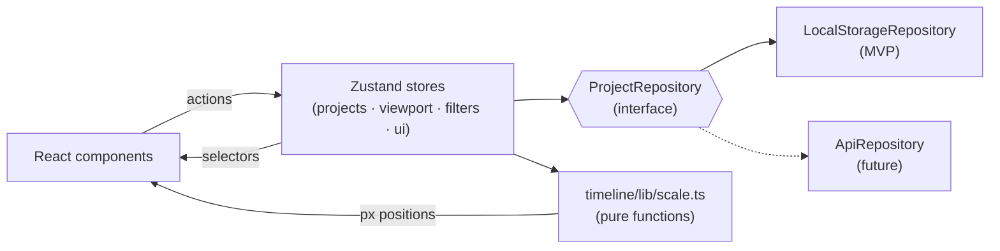

<div align="center">


# Horizon

**Plan your short, medium and long-term projects on a single, fluid timeline.**

A modern, keyboard-friendly Gantt-style planner that combines the planning power of MS Project with the minimal aesthetic of Linear, Notion and Raycast.

[](https://github.com/caiquemiranda/horizon-planner/actions/workflows/ci.yml)
[](https://github.com/caiquemiranda/horizon-planner/actions/workflows/deploy.yml)
[](https://www.typescriptlang.org/)
[](https://react.dev/)
[](./CHANGELOG.md)
[](./LICENSE)
[](https://www.conventionalcommits.org)

**[Live demo](https://caiquemiranda.github.io/horizon-planner/)** · [Features](#-features) · [Screenshots](#-screenshots) · [Getting started](#-getting-started) · [Architecture](#%EF%B8%8F-architecture) · [Roadmap](#%EF%B8%8F-roadmap) · [Contributing](#-contributing)

</div>

---

## ✨ Features

### MVP (`v0.1.0`)

| Area                         | What you get                                                                                                                                                                     |
| ---------------------------- | -------------------------------------------------------------------------------------------------------------------------------------------------------------------------------- |
| **Interactive timeline**     | Projects rendered as horizontal bars placed chronologically, grouped in collapsible **Short**, **Medium** and **Long-term** lanes.                                               |
| **Fluid macro ↔ micro zoom** | `Ctrl + Scroll` (or trackpad pinch) smoothly transitions from **Years / Semesters / Quarters** down to **Months / Weeks / Days**, always anchored on the point under the cursor. |
| **Navigation**               | Drag to pan, horizontal scroll, zoom presets and a **Go to today** action with a vertical "today" indicator.                                                                     |
| **Side drawer**              | Click any bar to open an animated drawer on the right. Create, edit and delete projects without losing the timeline context; edits show on the timeline in real time.            |
| **Rich project model**       | Title, description, horizon, start/end dates, progress (0–100%), status, color, category and milestones.                                                                         |
| **Filters**                  | Filter by horizon, category and status.                                                                                                                                          |
| **Lifecycle**                | Start, postpone (with an expected resume or revised finish), resume, complete, close without completing and reopen, each with its reason and a kept history.                     |
| **Sections and sidebar**     | Collapsible sidebar with **Active**, **Postponed**, **Not completed**, **Completed**, **Hidden** and **Trash**, each with its count and its own address.                         |
| **Hide and trash**           | Hide a project from the lists or move it to a restorable trash, both with undo; permanent deletion only from the trash.                                                          |
| **Meu painel**               | Projects started, completed and not completed in a period, completion rate and current states.                                                                                   |
| **Persistence**              | Automatic `localStorage` persistence behind a decoupled repository layer, ready to be swapped for a REST/GraphQL API.                                                            |
| **Portability**              | Schema-validated JSON export / import and opt-in **sample projects** ("Exemplos") for an instant demo.                                                                           |
| **Theming**                  | Dark mode by default, light mode supported, Geist typography and accessible contrast.                                                                                            |

### 🗂️ Project planning workspace

Open any project ("Abrir cronograma") to plan it in detail: an editable **task table (WBS)** side by side with a **Gantt chart**.

| Area                  | What you get                                                                                                                                         |
| --------------------- | ---------------------------------------------------------------------------------------------------------------------------------------------------- |
| **WBS / TreeGrid**    | Phases, tasks and subtasks at any depth, numbered `1`, `1.1`, `1.1.1`; inline editing with validation, expand/collapse, filter, keyboard navigation. |
| **Gantt chart**       | Bars on the same rows as the table, summary brackets, milestone diamonds, today line, calendar shading, its own zoom and pan, resizable split view.  |
| **Dependencies**      | Finish-to-start, start-to-start, finish-to-finish and start-to-finish links with lag/lead, drawn as orthogonal staircase arrows; cycles refused.     |
| **Scheduling engine** | Working-day calendar with holidays, automatic and manual tasks, propagation through the dependency graph, summary roll-up.                           |
| **Direct editing**    | Drag bars to move them and their edges to change dates; drag rows to reorder or nest; draw links from bar to bar.                                    |
| **Progress**          | Summary and project progress count tasks (each task weighs the same); the header shows how many are done.                                            |
| **Daily check-ins**   | "Atividades do dia" confirms the work planned for a day (or an earlier day) and lists late tasks.                                                    |
| **Finish forecast**   | Planned finish, forecast from the remaining work and the links, variance in working days with its causes, and an optional baseline.                  |
| **Expanded view**     | The workspace in a large dialog over the portfolio, without leaving the page.                                                                        |
| **Robustness**        | Saved per project with conflict detection across tabs, read-only closed projects, row virtualization for 1 000+ tasks.                               |

Design and acceptance status: [`docs/planning-module.md`](./docs/planning-module.md) · measurements: [`docs/performance.md`](./docs/performance.md) · lifecycle, progress and forecast: [`docs/implementation/`](./docs/implementation/horizon-extension-progress.md).

### ⌨️ Keyboard shortcuts

| Shortcut                  | Action                               |
| ------------------------- | ------------------------------------ |
| `Ctrl` + `Scroll` / pinch | Zoom anchored on cursor              |
| `Shift` + `Scroll` / drag | Pan through time                     |
| `+` / `-`                 | Zoom in / out                        |
| `←` / `→`                 | Pan (with `Shift`: a full page)      |
| `1` … `5`                 | Zoom presets: years, quarters … days |
| `T`                       | Go to today                          |
| `F`                       | Fit all projects                     |
| `?`                       | Show keyboard shortcuts              |
| `N`                       | New project                          |
| `Esc`                     | Close drawer                         |

## 📸 Screenshots

> Captured from the test portfolio with `npm run screenshots`. Assets live in [`docs/assets/`](./docs/assets); the [capture guide](./docs/assets/README.md) covers naming and the manual GIFs.





|                                          Micro view (weeks / days)                                           |                                               Side drawer (light theme)                                                |
| :----------------------------------------------------------------------------------------------------------: | :--------------------------------------------------------------------------------------------------------------------: |
|  |  |

<details>
<summary>More: light theme, dark drawer and phone layout</summary>




<p align="center"></p>

</details>

## 🚀 Getting started

> **Just want to try it?** Open the [live demo](https://caiquemiranda.github.io/horizon-planner/) and click **Explorar exemplos**. Your projects are saved only in your browser.

### Prerequisites

- **Node.js** `>= 20.19` (the version in [`.nvmrc`](./.nvmrc) is recommended: run `nvm use`)
- **npm** `>= 10`

### Installation

```bash
# 1. Clone the repository
git clone https://github.com/caiquemiranda/horizon-planner.git
cd horizon-planner

# 2. Install dependencies (this also installs the Git hooks)
npm install

# 3. Start the development server
npm run dev
```

Open <http://localhost:5173> and click **Explorar exemplos** (Explore examples) to open the sample projects right away.

### Available scripts

| Script                            | Description                                                 |
| --------------------------------- | ----------------------------------------------------------- |
| `npm run dev`                     | Starts the Vite dev server with HMR.                        |
| `npm run build`                   | Type-checks and builds the production bundle into `dist/`.  |
| `npm run preview`                 | Serves the production build locally.                        |
| `npm run typecheck`               | Runs the TypeScript compiler in strict mode (no emit).      |
| `npm run lint` / `lint:fix`       | Runs ESLint with type-aware rules / auto-fixes issues.      |
| `npm run format` / `format:check` | Formats / checks formatting with Prettier.                  |
| `npm test`                        | Runs the test suite once with Vitest.                       |
| `npm run test:watch`              | Runs Vitest in watch mode.                                  |
| `npm run test:coverage`           | Runs the tests and writes a coverage report to `coverage/`. |
| `npm run test:e2e`                | Runs the browser end-to-end tests (Playwright, Chrome).     |
| `npm run screenshots`             | Builds the app and recaptures the README screenshots.       |
| `npm run perf`                    | Measures the planning workspace with 100–1 000 tasks.       |

## 🏗️ Architecture

### Tech stack

| Layer      | Choice                                           | Why                                                                                          |
| ---------- | ------------------------------------------------ | -------------------------------------------------------------------------------------------- |
| Core       | **React 19 + TypeScript (strict) + Vite 7**      | Fast DX, strict typing with `noUncheckedIndexedAccess` and `exactOptionalPropertyTypes`.     |
| UI         | **Tailwind CSS v4 + shadcn/ui (Radix) + Lucide** | Accessible primitives, design tokens as CSS variables, full ownership of the components.     |
| Motion     | **Motion**                                       | Drawer and micro-interactions only. The timeline runs its own `requestAnimationFrame` loop.  |
| State      | **Zustand**                                      | Small, selector-based stores that avoid re-rendering the whole timeline on every zoom frame. |
| Dates      | **date-fns**                                     | Precise, tree-shakeable calendar math and `pt-BR` formatting.                                |
| Validation | **zod**                                          | Runtime validation of imported JSON and persisted data.                                      |
| Tests      | **Vitest + React Testing Library**               | The pure scale and layout logic is fully unit-tested.                                        |

### How the timeline works

The timeline is rendered with **plain DOM and GPU-accelerated transforms**, driven by a pure scale engine:

- **Continuous zoom.** The zoom level is a single number, `pxPerDay` (about `0.02` for decades up to about `160` for hours). The ruler picks its granularity (Year → Semester → Quarter → Month → Week → Day) from that value.
- **Cursor-anchored zoom.** `zoomAt(viewport, cursorX, factor)` recomputes the left edge so the date under the cursor stays on the same pixel.
- **Smooth interpolation.** Wheel events set a target viewport, and a `requestAnimationFrame` loop eases towards it.
- **Day numbers.** Dates are converted to fractional _days since epoch_ for all pixel math, which avoids timezone and DST bugs. `date-fns` handles calendar boundaries and labels.

> Canvas renderers (Konva, PixiJS) and off-the-shelf Gantt libraries were evaluated and rejected for the MVP. See [ADR-001](./docs/architecture.md#adr-001-dom-rendering-with-a-custom-scale-engine).

### Data flow



### Folder structure

```text
src/
├── app/                    # Entry point, root layout and providers
├── components/
│   ├── ui/                 # shadcn/ui primitives (owned code, not a dependency)
│   └── layout/             # App header, theme toggle
├── features/               # Feature-based modules
│   ├── timeline/           # Canvas, ruler, bars, zoom and pan hooks
│   │   ├── components/
│   │   ├── hooks/
│   │   ├── lib/            # ⚙️ Pure scale, ticks and layout engine (fully tested)
│   │   └── store/
│   ├── projects/           # Drawer, form, milestones, projects store, zod schemas
│   ├── filters/            # Filter bar and filtering logic
│   ├── examples/           # Sample projects ("Exemplos") and their copy
│   └── data-io/            # Export and import (JSON, Excel/CSV)
├── services/
│   └── persistence/        # Repository contract + localStorage / in-memory implementations
├── lib/                    # Cross-cutting utilities
├── types/                  # Shared domain types (Project, Viewport…)
├── styles/                 # Tailwind entry and design tokens
└── test/                   # Test setup and browser API mocks
scripts/                    # Maintenance scripts (README screenshots)
```

Key architectural decisions are recorded as lightweight ADRs in [`docs/architecture.md`](./docs/architecture.md).
Visual decisions (colors, typography, spacing, motion and component rules) are documented in the [design system](./docs/design.md).

### Engineering standards

- **GitHub Flow with a `develop` branch.** `main` is protected and only receives releases; features reach `develop` through pull requests.
- **Conventional Commits**, enforced locally by **Husky + Commitlint** and in CI on every pull request.
- **lint-staged** runs ESLint and Prettier on staged files before each commit.
- **CI** (GitHub Actions) runs the format check, lint, type-check, tests with coverage, the build and browser end-to-end tests on every pull request.
- **CD** publishes the app to [GitHub Pages](https://caiquemiranda.github.io/horizon-planner/) on every push to `develop`.
- **Semantic Versioning** with a human-readable [`CHANGELOG.md`](./CHANGELOG.md).

## 🗺️ Roadmap

- [x] Repository setup, tooling and CI
- [ ] **v0.1.0 (MVP):** interactive timeline, macro/micro zoom, drawer CRUD, filters, localStorage, JSON import/export, sample data
- [x] Project planning workspace: WBS table, Gantt chart, dependencies, scheduling engine
- [x] Drag and resize bars to change dates (in the project workspace)
- [x] Row virtualization (project workspace)
- [ ] Critical path (CPM) and baselines
- [ ] Undo / redo (command history)
- [ ] Command palette (`Ctrl + K`)
- [ ] PWA with offline support
- [ ] Backend sync (REST API + authentication) through a new `ProjectRepository` implementation
- [ ] Automated releases with `release-please`
- [ ] i18n (`pt-BR` / `en`)

## 🤝 Contributing

Contributions are welcome. Please read the [contributing guide](./CONTRIBUTING.md) for the branch strategy, commit conventions and pull request process.

1. Fork the repository and create a branch from `develop`: `git checkout -b feat/my-feature`
2. Commit using Conventional Commits: `git commit -m "feat(timeline): add zoom presets"`
3. Push and open a pull request against `develop`

## 📄 License

Distributed under the **MIT License**. See [`LICENSE`](./LICENSE) for details.

<div align="center">
<sub>Built by <a href="https://github.com/caiquemiranda">Caique Miranda</a>.</sub>
</div>
